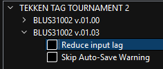

A quick one for now. I've been digging into a bit of reverse engineering as of late.

There's a patch for Tekken Tag Tournament 2 in RPCS3 that caught my attention: "Reduce input lag".

This patch shaves two frames of input delay off the game in offline modes. You just toggle it on in the emulator and you're done.

I wanted the patch on PS3 hardware.

## RPCS3's patch.yml

RPCS3 keeps its patches in a single `patch.yml`. Each patch is keyed by a SHA-1 hash of the loaded PPU module (the game's main executable), and underneath are one or more entries. An entry is a small tuple: a type (something like `be32` for a big-endian 32-bit integer), a runtime virtual address, and the value to write there. So a patch is really just a list of byte writes against specific addresses in memory.

The hash is the interesting part. RPCS3 derives it from the ELF's program headers and segment payloads in a particular order. If I recompute that same hash on a real PS3 ELF, I'd have the same key into `patch.yml` that the emulator uses.

## The plan

It something like this:

1. Decrypt the game's `EBOOT.BIN` into an ELF.
    - RPCS3 already has this function
2. Compute the PPU hash on that ELF the way RPCS3 does it.
3. Look up the patch in `patch.yml` by hash, translate each entry's virtual address into a file offset using the ELF's PT_LOAD segments, and write the encoded value.
4. Re-encrypt the patched ELF back into a fake-signed `EBOOT.BIN` that CFW will accept.
    - oscetool does this
5. FTP it onto the PS3, run the game.

## The script

I wrote a small Ruby script for the middle bit. Given a decrypted ELF and a patch name, it derives the PPU hash, finds the matching entries, applies each one to the byte buffer, and writes a new ELF. Ruby's `Array#pack` and `String#unpack` handle big-endian format codes natively. `N` for 32-bit, `Q>` for 64-bit, and `g` and `G` for floats. PS3 executables are big-endian ELF64, so the encoders for each patch type ended up being one-liners.

This can be re-written into Python if there's demand; I'm more familiar with Ruby so I stuck with it.

I've uploaded the script here: https://github.com/tbender4/ps3_elf_patcher

It haven't tested it past Tekken Tag Tournament 2. YMMV.

## Re-encrypting

After the script writes the patched ELF, the result has to be encrypted to run on the PS3. I used [OpenSCETool](https://github.com/spacemanspiff/oscetool) for this.

## Deployment

This requires a modded PS3. FTP into the PS3, navigate to `/dev_hdd0/game/<TITLEID>/USRDIR/`, back up the existing `EBOOT.BIN`, and drop in the patched copy.

And that's a wrap! Here's a quick video of Practice Mode in PS3 with the input lag option effectively no-oped and second video showing the Skip Auto-Save Warning patch: https://x.com/tbender95/status/2053582940504773034